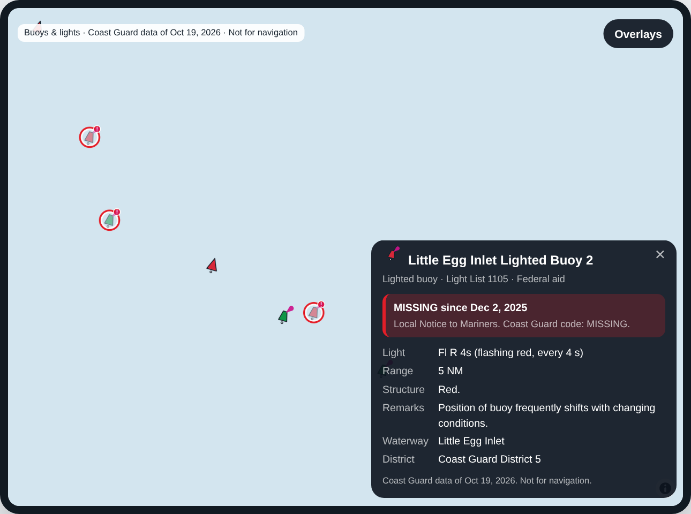

# Vector Marine buoys & lights

**Overlays → Buoys & lights** in the app: every US Coast Guard aid to navigation from Maine to Florida and
Puerto Rico (Coast Guard districts 1, 5 and 7, about 32,400 aids), drawn with our own chart-like symbols and
kept current daily.

- **Symbols**: green cans and red nuns, lighted buoys with a magenta light flare, safe water, special purpose,
  preferred channel, isolated danger and regulatory marks, square and triangle daybeacons, minor and major
  lights, ranges, racons, virtual AIS aids, sound signals. Major lights show from zoom 6, sea buoys from 8, the
  other lighted aids from 9, everything from 11. From zoom 14 the light and number sit beside each aid, like
  the chart: `Fl G 4s "3"`.
- **Outages**, from the Coast Guard's Local Notice to Mariners: a **red ring** when the aid is missing, off
  station or destroyed (drawn faded), **amber** when its light is out or it's damaged, **grey dashed** for a
  temporary change (discontinued, relocated for dredging, temporarily replaced).
- **Tap an aid**: its name, Light List number, kind, light (`Fl G 4s (flashing green, every 4 s)`), range,
  height, structure, remarks, private or federal, waterway, and its status with the date it was reported
  (`MISSING since Dec 2, 2025`). The data date and "Not for navigation" are on the map and on every card.

Its own repo, Flutter package (`vm_aton`), Worker (`aton.vectormarine.us`) and R2 bucket (`vm-aton`): it ships
as one feature and nothing in it can affect the chart or another overlay. Free to run: public data (USCG
NAVCEN), GitHub Actions, Cloudflare R2 and Workers (one small daily cron on the Workers Paid plan the account
already has). Nothing about the user leaves the phone.



**Status (Oct 19, 2026):** pipeline, Worker and preview built and tested (`bash check.sh`); checked on the real
Coast Guard files of Oct 19, 2026 (`docs/img/`). The Flutter package is written and its tests are ready, but it
has **not been compiled yet** (no Flutter SDK where it was written): work package 1. Nothing is deployed:
`docs/IMPLEMENTATION_PLAN.md`.

## Quick start

On a Mac with Node 18+ and Python 3 (no account needed):

```bash
cd ~/Projects/vector-marine-aton
bash local.sh
```

That downloads the Coast Guard's files (about 15 MB), builds the whole coast (about 30 s), starts the real
Worker on port 8787 and the app preview on port 8790, and opens it on Barnegat Inlet. `bash local.sh sample`
is a quick look with made-up data; `RAW=/path/to/files bash local.sh` builds from copies of the files.

The Flutter example app (needs Xcode or Android Studio), in a second tab while `local.sh` runs:

```bash
bash local_app.sh
```

## How it works

```
Worker vm-aton cron, 10:20 UTC (retry 10:40): NAVCEN files ─► R2 raw/<date>/ (_complete.json last)
                                                       │
GitHub Actions, daily 10:50 UTC (pipeline/)          R2 bucket vm-aton        Worker vm-aton              App
NAVCEN Light List (lightList{D}_{n}.csv)  ─┐         aton.pmtiles             aton.vectormarine.us        Overlays → Buoys & lights
Local Notice to Mariners discrepancies    ├─► run_aton.py ─► icons/, style.json ─► /meta.json, /style.json ─► vm_aton package
 and temporary changes (*.geojson)        ─┘         meta.json (last)         /aton/{z}/{x}/{y}.mvt       (last copy kept on the phone)
                                          publish.py                          /icons/… (API key, edge cache)
```

0. NAVCEN refuses GitHub's machines, so the Worker downloads: its daily cron (`worker/src/mirror.js`) copies
   the day's files into the bucket's `raw/<date>/`, unchanged, and writes `_complete.json` only when all are
   there. The Action copies them out (`pipeline/tools/fetch_raw.py`, which keeps the Coast Guard's dates) and
   builds with `--raw`. A day without a complete copy isn't built; the published build stays.
1. `pipeline/run_aton.py` downloads the Light List of districts 1, 5 and 7 (counting its parts until one isn't
   there) and the current discrepancies and temporary changes, puts each notice on its aid (Light List number,
   else the same name within 300 m; notices that match nothing are still shown, at their own position),
   picks each aid's symbol, and writes vector tiles (`aton.pmtiles`, z6–14), the symbols at 1x/2x/3x,
   `style.json` and `meta.json`. It refuses to write a build where a district has far fewer aids than the last
   published one.
2. `pipeline/publish.py` uploads it, `meta.json` last.
3. The Worker (`worker/`) checks the API key, reads tiles out of `aton.pmtiles` with range requests, and serves
   the files. A failed job can't break the map: the last build stays, and the app says when it's more than 72
   hours old.
4. The Flutter package (`flutter/vm_aton/`) loads meta, style and symbols when switched on, adds the source and
   layers under the map's `vm-overlays` anchor, and shows the card on a tap, worked out on the phone.
5. `preview/` is the same overlay as a web page on the real files: the reference for how it should look.

## Repo

```
pipeline/          the daily job (Python): run_aton.py, publish.py, vmaton/, config/, tests/, tools/
worker/            Cloudflare Worker "vm-aton": tiles from aton.pmtiles in R2, API keys, edge cache
flutter/vm_aton/   Flutter package: AtonController, AtonMapLibre, AtonCard, AtonNote (+ example/)
preview/           the overlay as a web page on the real files; aton.js = the words in JS
docs/              IMPLEMENTATION_PLAN, SPEC, API, DATA, SETUP, RUNBOOK, QA_CHECKLIST, ai/APP_REPO_CONTEXT, img/
check.sh           every check;  local.sh: everything locally;  local_app.sh: the Flutter example against it
```

Working on it with an AI assistant: `AGENTS.md` (Claude Code reads it through `CLAUDE.md`), and a kickoff
prompt per work package in `docs/IMPLEMENTATION_PLAN.md`.

Not for navigation.
